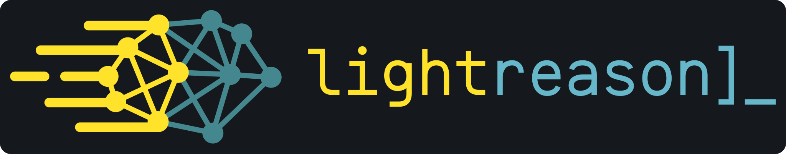

# Lightreason

Lightreason runs the original BF16 **Qwen2.5-3B-Instruct** on NVIDIA CUDA. Live Studio can generate a single-file web page, preview it in an isolated iframe, and compare the standard and Lightreason Exact runners with the same model and prompt.

The source is [0BSD](LICENSE). [Transparent logo](demo_chat/static/lightreason.svg). The pinned Qwen checkpoint has separate [research-only terms](THIRD_PARTY.md). This release contains code and input fixtures, with model downloads handled separately.

## Run on a GPU machine

Tested configuration: Linux, Python 3.12, RTX 4090, PyTorch 2.9.1 with CUDA 12.8, and Transformers 4.57.1. Use a CUDA driver compatible with the PyTorch wheel. Allow about 6.2 GB for the target checkpoint download plus installation and cache space.

```bash
git clone https://github.com/me-farza/lightreason.git
cd lightreason
git checkout v0.1.0
python3.12 -m venv .venv
source .venv/bin/activate
python -m pip install 'torch==2.9.1' --index-url https://download.pytorch.org/whl/cu128
python -m pip install -r requirements.txt
python download_3b.py --destination model-3b
python -m demo_chat.server --model-path model-3b
```

`download_3b.py` checks the official objects against the pinned [download plan](results3b/download-plan.json). Read the [Qwen license](https://huggingface.co/Qwen/Qwen2.5-3B-Instruct/blob/aa8e72537993ba99e69dfaafa59ed015b17504d1/LICENSE) before downloading or using the model.

Open **<http://127.0.0.1:8765/>**. If CUDA runs on another machine, forward the loopback port from your browser machine:

```bash
ssh -N -L 127.0.0.1:8765:127.0.0.1:8765 YOUR_GPU_HOST
```

The server exposes readiness at `/api/status`. Standard is available after the model loads. Exact prepares execution graphs on demand; the first run at a new shape can take longer. Studio displays generation and browser rendering separately. Generated code runs inside the sandboxed browser preview.

To generate from the command line:

```bash
python run_model_3b.py --model-path model-3b --engine original --prompt 'Explain why the sky is blue.'
python run_model_3b.py --model-path model-3b --engine bucketed --prompt 'Explain why the sky is blue.'
```

## Edit a page

**New app** generates a page. **Edit current app** supplies its HTML and asks Qwen for the full update. **Patch edit (experimental)** asks Qwen for one small JSON search-and-replace, checks it against the current HTML, and renders the reconstructed document after successful completion. Use the full edit path for larger changes or to retry a rejected patch. A successful patch currently reloads the sandboxed preview, which restarts page state.

The two patch formats, their local HTTP benchmarks, and known failures are described in [the benchmark notes](docs/benchmarks.md).

## Optional draft-assisted research

Standard and Exact run with the target checkpoint alone. The optional Turbo runner and the GPU coordination benchmark additionally require the pinned AMD PARD2 draft directory and the matching trained LoRA/projector checkpoint supplied locally. See [the optional setup and reproduction commands](docs/benchmarks.md). That adapter is separate from this source release.

Run the CPU-side Studio contract tests from the repository root:

```bash
python -m unittest discover -s demo_chat -p 'test_*.py'
node demo_chat/test_preview.js
```
